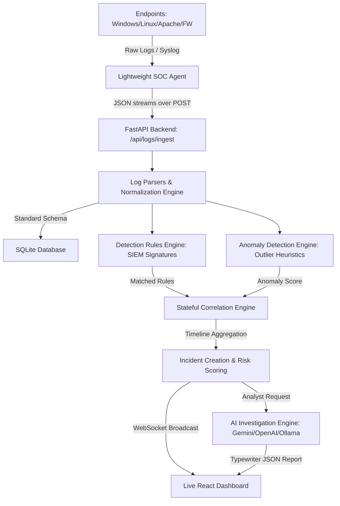

# SentinelAI: Autonomous AI SOC & Threat Investigation Platform

SentinelAI is a production-quality, modular, autonomous cybersecurity SIEM/XDR platform. It features client-side agent collectors, raw log parsers, unified schema normalizers, rule-based detection engines, event correlation pipelines, statistical anomaly scoring, and automated AI incident analysis.

---

## 🏗️ System Architecture



---

## 📁 Project Modules

- **`/backend`**: Python FastAPI app managing parsing, rules, correlation, risk scoring, SQLite storage, WebSockets, and AI investigations.
- **`/agent`**: Lightweight multi-threaded Python agent. Collects Windows Event logs, Linux syslog/auth files, tails Apache access logs, and receives network syslog traffic on UDP port 5140.
- **`/frontend`**: React + TypeScript + Tailwind CSS dashboard presenting risk heatmaps, area charts, host health, and a dynamic MITRE ATT&CK Matrix.
- **`/tests`**: Unit test suite using Pytest for the parser, rules, correlation, and anomaly detectors.

---

## ⚡ Quick Start Instructions

### Prerequisites
- Python 3.12+ (Tested on 3.14.3)
- Node.js 18+ & npm

---

### Step 1: Set Up and Run the Backend

1. Navigate to the project root and ensure the virtual environment is ready:
   ```bash
   python -m venv .venv
   .venv\Scripts\activate      # On Windows
   source .venv/bin/activate   # On Linux/macOS
   ```
2. Install Python dependencies:
   ```bash
   pip install -r backend/requirements.txt
   ```
3. Set up the environment variables:
   - Copy `backend/.env.example` to `backend/.env`
   - Fill in your `GEMINI_API_KEY` or `OPENAI_API_KEY` (if using AI, otherwise the platform falls back to realistic mock security reports automatically).
4. Run the FastAPI backend:
   ```bash
   uvicorn backend.app.main:app --reload --host 127.0.0.1 --port 8000
   ```
5. View Swagger API documentation at: [http://127.0.0.1:8000/docs](http://127.0.0.1:8000/docs)

---

### Step 2: Set Up and Run the Frontend

1. Open a new terminal and navigate to the `/frontend` directory:
   ```bash
   cd frontend
   npm install
   ```
2. Launch the Vite React development server:
   ```bash
   npm run dev
   ```
3. Open your browser to the URL displayed (typically [http://localhost:5173](http://localhost:5173)).
4. **Log In Credentials (seeded on startup)**:
   - **Admin Analyst (full access)**: `admin` / `admin123`
   - **Triage Analyst (view-only rules)**: `analyst` / `analyst123`

---

### Step 3: Run the SOC Agent (Endpoint Simulation)

To collect local OS logs, start the endpoint agent:
```bash
# In the active virtual environment:
python agent/agent.py
```
- On **Windows**: Reads event logs directly (requires Admin, falls back to simulation mode if pywin32 is absent).
- On **Linux**: Tails `/var/log/auth.log` and `/var/log/syslog` (requires sudo).
- The agent runs a **Syslog server** on UDP port `5140`. Firewalls can stream traffic directly there.

---

### Step 4: Run Attacks with the Simulator

Since local environments may lack active attacks, navigate to the **Attack Simulator** tab in the dashboard:
- Trigger scenarios like **RDP/SSH Brute Force**, **SQL Injection**, **Port Scan**, or **Insider Threat**.
- Watch the **Dashboard** update instantly in real-time as logs stream through the normalization, detection, and correlation engines.
- Open an incident, click **Initialize AI Agent**, and review the generated containment steps.
- Click **Export PDF** to download a formatted triage report.

---

## 🧪 Verification & Testing

Verify system calculations by running unit tests:
```bash
# From the project root
.venv\Scripts\python -m pytest tests/
```
All tests verify parsing correctness, rule evaluations, sliding-window correlation counts, and anomaly heuristics.
